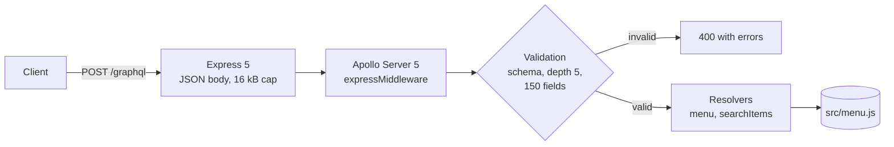

# Restaurant Menu GraphQL API

A small GraphQL API that serves a restaurant's lunch menu: appetizers, entrees, sandwiches, soups, fajitas, tacos, enchiladas, quiche and green salads. Clients ask for exactly the categories and fields they need, or search across the whole menu by dish or ingredient.

It is built on Apollo Server 5 and Express 5. The menu itself is a static module (`src/menu.js`), so there is no database to run.

## How a request flows



| Path | What it is |
| --- | --- |
| `src/index.js` | Starts the HTTP server on `PORT` (default 3000) and drains it on shutdown |
| `src/server.js` | `createApp()`: the Express app, body limit and JSON error handler |
| `src/graphql/apollo.js` | Apollo Server setup: resolvers, error formatting, introspection, landing page |
| `src/graphql/typeDefs.js` | The schema |
| `src/graphql/limits.js` | Validation rule capping query depth and field count |
| `src/graphql/searchItems.js` | Search across categories, with argument validation |
| `src/menu.js` | The menu data |

## Running it

With Docker (no local Node needed):

```sh
docker build -t restaurant-menu-graphql-api .
docker run --rm -p 3000:3000 restaurant-menu-graphql-api
```

The image runs as the unprivileged `node` user with `NODE_ENV=production`.

Locally, with Node 22 (see `.nvmrc`) and Yarn 1 (`corepack enable` provides it if `yarn` is missing):

```sh
yarn install
yarn start        # http://localhost:3000/graphql
yarn test         # Vitest + supertest
yarn lint         # ESLint
```

`GET /` returns `{"status":"ok","graphql":"/graphql"}` and serves as a health check.

### Configuration

There are only two settings, both environment variables:

| Variable | Effect |
| --- | --- |
| `PORT` | Port to listen on. Default `3000`. |
| `NODE_ENV` | `production` turns off introspection and the landing page and masks internal error messages. `development` adds stack traces to error responses. Anything else (including unset) gives introspection without stack traces. |

Outside production, opening `/graphql` in a browser shows Apollo's landing page, which loads Apollo Sandbox from Apollo's CDN.

## Schema

```graphql
type MenuItem {
  name: String!
  ingredients: String!
  price: Float!
}

type Category {
  description: String
  items: [MenuItem!]!
}

type Menu {
  appetizers: Category!
  entrees: Category!
  sandwiches: Category!
  soupAndSalad: Category!
  fajitas: Category!
  tacos: Category!
  enchiladas: Category!
  quiche: Category!
  greenSalads: Category!
}

type SearchResult {
  category: String!   # e.g. "greenSalads"
  item: MenuItem!
}

type Query {
  menu: Menu!
  searchItems(term: String!, maxPrice: Float): [SearchResult!]!
}
```

## Examples

These requests and responses were captured from the Docker image above (so `NODE_ENV=production`). Responses are pretty-printed here.

### One category

```sh
curl -s localhost:3000/graphql -H 'content-type: application/json' \
  -d '{"query":"{ menu { fajitas { description items { name ingredients price } } } }"}'
```

```json
{
  "data": {
    "menu": {
      "fajitas": {
        "description": "Served with red rice, black beans, grilled tomato salad, choice of corn or flour tortillas",
        "items": [
          {
            "name": "Chicken Fajita",
            "ingredients": "Onions, Poblano and Bell Peppers, Guacamole, Two Salsas",
            "price": 10.95
          },
          {
            "name": "Sirloin Steak Fajita",
            "ingredients": "Onions, Poblano and Bell Peppers, Carrots, Onion, Guacamole, Two Salsas",
            "price": 10.95
          }
        ]
      }
    }
  }
}
```

### Search by ingredient and price

`searchItems` matches the term against each dish's name and ingredients, ignoring case and surrounding spaces, and returns the cheapest first. `maxPrice` is inclusive.

```graphql
query Search($term: String!, $maxPrice: Float) {
  searchItems(term: $term, maxPrice: $maxPrice) {
    category
    item { name price }
  }
}
```

With variables `{"term": "guacamole", "maxPrice": 10}`:

```json
{
  "data": {
    "searchItems": [
      { "category": "sandwiches", "item": { "name": "Mexi Burger*", "price": 9.25 } },
      { "category": "tacos", "item": { "name": "Carne Asada Tacos", "price": 9.95 } },
      { "category": "tacos", "item": { "name": "Citrus Marinated Chicken Tacos", "price": 9.95 } },
      { "category": "tacos", "item": { "name": "Grilled Veggie Tacos", "price": 9.95 } }
    ]
  }
}
```

### Invalid arguments

The term must be 2 to 50 characters after trimming, and `maxPrice` cannot be negative. `{ searchItems(term: "a") { item { name } } }` returns HTTP 200 with:

```json
{
  "errors": [
    {
      "message": "term must be 2 to 50 characters long.",
      "locations": [{ "line": 1, "column": 3 }],
      "path": ["searchItems"],
      "extensions": { "code": "BAD_USER_INPUT", "argumentName": "term" }
    }
  ],
  "data": null
}
```

### Unknown fields

`{ menu { continental { description } } }` is rejected before anything runs, with HTTP 400:

```json
{
  "errors": [
    {
      "message": "Cannot query field \"continental\" on type \"Menu\".",
      "locations": [{ "line": 1, "column": 10 }],
      "extensions": { "code": "GRAPHQL_VALIDATION_FAILED" }
    }
  ]
}
```

### Oversized queries

A query that repeats `m0: menu { quiche { description } }` under 60 aliases selects 180 fields, and gets HTTP 400:

```json
{
  "errors": [
    {
      "message": "Query selects 180 fields; the limit is 150.",
      "locations": [{ "line": 1, "column": 1 }],
      "extensions": { "code": "GRAPHQL_VALIDATION_FAILED" }
    }
  ]
}
```

## Design notes

- **Query limits without a dependency.** GraphQL lets a client multiply work with aliases and fragments. `src/graphql/limits.js` is a validation rule of about 60 lines that walks each operation, follows fragments (guarding against cycles) and rejects anything deeper than 5 levels or wider than 150 fields. The full menu is about 55 fields, so real queries fit comfortably. Introspection fields are skipped, because introspection is switched on or off separately.
- **Errors that don't leak.** Apollo only hides stack traces when `NODE_ENV` is `production` or `test`, so an unset `NODE_ENV` used to expose them. Here stack traces appear only in `development`. In production, unexpected resolver errors become `Internal server error`, while deliberate errors such as `BAD_USER_INPUT` keep their message. Malformed or oversized JSON bodies get a JSON error rather than Express's HTML error page.
- **`createApp()` instead of a module-level server.** The app is built by a function that takes the menu and environment, so the tests run production and development configurations side by side and can inject a failing menu to check error masking.
- **Static data.** The menu is a plain module. Swapping in a database would only change the two resolvers in `src/graphql/apollo.js`.

## Tests

`yarn test` runs 53 Vitest tests in `__tests__/`:

- `server.test.js`: menu queries over HTTP, unknown fields, alias floods, cyclic fragments, bad and oversized bodies, introspection on and off, error masking in production and stack traces in development.
- `searchItems.test.js`: matching, price filter, empty results and each validation error.
- `limits.test.js`: the depth and field rule against a small recursive schema.
- `menu.test.js`: the data itself (unique names, no HTML entities or stray line breaks, positive prices).

The API is read-only, so there are no mutations to test.

## License

MIT, see [LICENSE](LICENSE).
